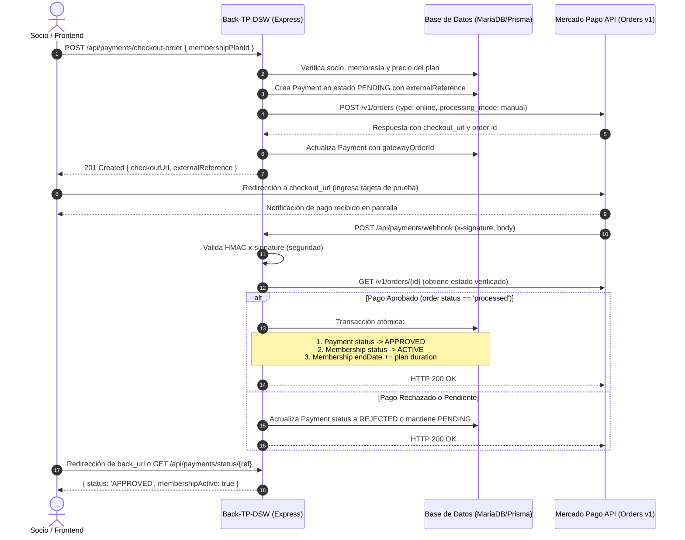

# Arquitectura y Diseño Técnico: Integración Mercado Pago Orders API

Este documento define la arquitectura técnica, las modificaciones de modelo de datos y el flujo de comunicación entre componentes para implementar **Checkout Pro con Orders API**.

---

## 1. Análisis del Estado Actual vs. Estado Propuesto

### Estado Actual del Módulo de Pagos
- **Modelo Prisma `Payment`:**
  - Registra pagos de forma manual (habitualmente ejecutados por el rol `ADMIN`).
  - No tiene concepto de estado del pago (`status`): todo pago insertado se considera inmediatamente efectivo.
  - No almacena identificadores externos (`gatewayOrderId`, `externalReference`, `gatewayPaymentId`).
  - Actualiza la fecha de fin de la membresía en el instante en que el administrador crea el pago.
- **Limitación:** Un socio (`MEMBER`) no puede auto-gestionar su pago en línea con una pasarela real o de prueba, ni tolerar pagos pendientes, rechazados o cancelados.

### Estado Propuesto
1. **Evolución del Modelo de Datos (Prisma):**
   - Incorporar enum `PaymentStatus` con valores: `PENDING`, `APPROVED`, `REJECTED`, `CANCELLED`, `REFUNDED`.
   - Incorporar enum o método `PaymentMethod` con soporte de `MERCADO_PAGO` (o mantener mapping).
   - Agregar campos opcionales en `Payment`:
     - `status`: `PaymentStatus` (por defecto `APPROVED` para pagos manuales históricos de Admin, o `PENDING` para órdenes iniciadas en línea).
     - `externalReference`: `String? @unique` (identificador único generado por el sistema).
     - `gatewayOrderId`: `String?` (identificador devuelto por Mercado Pago Orders API).
     - `gatewayPaymentId`: `String?` (identificador del pago específico reportado por MP).

2. **Nuevo Módulo / Servicio de Pasarela (`MercadoPagoService`):**
   - Encapsula el SDK o cliente HTTP de Mercado Pago.
   - Aislado del resto de la lógica de negocio para permitir mockeos sencillos en pruebas unitarias.

3. **Flujo de Endpoints:**
   - `POST /api/payments/checkout-order`: Socio autenticado solicita pagar un plan para su membresía.
   - `POST /api/payments/webhook`: Endpoint público donde Mercado Pago notifica el cambio de estado de la orden o pago.
   - `GET /api/payments/status/:externalReference`: Consulta del estado actual del pago desde el frontend para polling o feedback tras la redirección.

---

## 2. Diagrama de Secuencia Detallado



---

## 3. Estructura de la Orden en Mercado Pago (Orders API)

Para Checkout Pro, el cuerpo enviado a `POST /v1/orders` sigue este formato:

```json
{
  "type": "online",
  "processing_mode": "manual",
  "total_amount": "25000.00",
  "external_reference": "ORDER_MEM_7_1740612345",
  "items": [
    {
      "id": "plan-premium-mensual",
      "title": "Membresía Mensual Premium",
      "quantity": 1,
      "unit_price": "25000.00",
      "unit_measure": "unit",
      "currency_id": "ARS"
    }
  ],
  "payer": {
    "email": "test_user_123456@testuser.com",
    "first_name": "Juan",
    "last_name": "Pérez"
  },
  "notification_url": "https://<tu-dominio-publico-o-ngrok>/api/payments/webhook"
}
```

### Estructura del Webhook (Orders API - Topic `Order`)
Mercado Pago envía una notificación HTTP POST con `type: "order"` y `action: "order.processed"`:

```json
{
  "action": "order.processed",
  "api_version": "v1",
  "data": {
    "id": "ORD01M28P44G5FG8RJPM579EH56FV",
    "status": "processed",
    "status_detail": "accredited",
    "total_amount": "25000.00",
    "external_reference": "ORDER_MEM_7_1740612345",
    "transactions": {
      "payments": [
        {
          "id": "PAY01M28P44GDSD4JYTSK5SYZT6BH",
          "status": "processed",
          "status_detail": "accredited"
        }
      ]
    }
  },
  "type": "order"
}
```

Las cabeceras HTTP incluyen:
- `x-signature`: firma HMAC para verificación de autenticidad con el secreto de la app.
- `x-request-id`: identificador de la petición de notificación.


---

## 4. Estructura de Módulos y Clases

Para respetar la arquitectura existente del proyecto (`repository`, `service`, `controller`, `routes`, `instances.ts`):

```
src/
├── config/
│   └── mercadopago.config.ts        <-- Inicialización de credenciales y cliente MP
├── modules/
│   ├── payment/
│   │   ├── payment.controller.ts     <-- Manejadores HTTP (checkout, webhook, manuales)
│   │   ├── payment.repository.ts     <-- Consultas Prisma con nuevos campos
│   │   ├── payment.routes.ts         <-- Definición de rutas públicas y protegidas
│   │   ├── payment.schemas.ts        <-- Esquemas Zod para checkout y webhook
│   │   ├── payment.service.ts        <-- Lógica de negocio y orquestación
│   │   └── mercadopago.service.ts    <-- Llamadas al SDK/API de Mercado Pago
```

